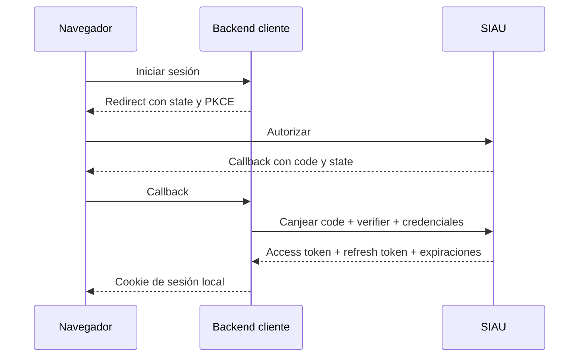

# Integración de una aplicación cliente

Esta es la guía oficial para conectar una aplicación con SIAU. La integración debe resolverse en el backend del cliente: el navegador nunca recibe el secreto ni los tokens emitidos por SIAU.

Los detalles del protocolo están en [SSO y Single Logout](sso-flow.md). La arquitectura interna de SIAU está en [Visión general](overview.md).

## 1. Registrar la aplicación

Solicita un registro por cada ambiente y conserva estos datos:

- `clientId`: identificador único del cliente;
- `clientSecret`: credencial del backend, mostrada al crearla o regenerarla;
- `launchUrl`: URL que usa el portal de SIAU para iniciar la aplicación; normalmente apunta al endpoint del backend que comienza el flujo SSO, no necesariamente al `/home` ni al frontend principal;
- `redirectUris`: callbacks permitidos; SIAU exige coincidencia exacta;
- `backchannelLogoutUri`: endpoint del backend que recibirá notificaciones de cierre de sesión.

Registra la aplicación como **confidential client**. Guarda el secreto en un gestor de secretos o en variables protegidas; no lo incluyas en código, repositorios, logs ni respuestas al frontend. Regenerarlo invalida el valor anterior.

El administrador de SIAU también debe habilitar para la aplicación a los usuarios que podrán acceder a ella.

## 2. Configurar el backend cliente

Estos nombres son ilustrativos; usa equivalentes en tu plataforma:

| Variable | Contenido |
| --- | --- |
| `SIAU_BASE_URL` | URL pública de SIAU y valor esperado de `iss`. |
| `SIAU_CLIENT_ID` | `clientId` asignado. |
| `SIAU_CLIENT_SECRET` | Secreto del cliente confidencial. |
| `SIAU_REDIRECT_URI` | Callback exacto registrado para el ambiente. |
| `SIAU_BACKCHANNEL_LOGOUT_URI` | URL exacta del receptor de Single Logout. |

A partir de `SIAU_BASE_URL` se usan `/oauth/authorize`, `/oauth/token`, `/.well-known/jwks.json` y `/internal/sessions/logout`. No compartas configuración ni secretos entre desarrollo, pruebas y producción.

La configuración del almacenamiento, cookie y protección de la sesión local pertenece al cliente y depende de su framework; no forma parte de la configuración exigida por SIAU.

## 3. Implementar Authorization Code + PKCE

Por cada inicio de sesión, el backend cliente debe:

1. Generar un `state` aleatorio, de un solo uso, para proteger el callback.
2. Generar un `code_verifier` PKCE y su `code_challenge` con `S256`.
3. Guardar `state` y `code_verifier` del lado servidor, asociados al navegador.
4. Redirigir el navegador a `/oauth/authorize` con `response_type=code`, `client_id`, `redirect_uri`, `state`, `code_challenge` y `code_challenge_method=S256`.
5. En el callback, comparar y consumir `state`. Rechazar valores ausentes, vencidos o diferentes.
6. Canjear el `code` desde el backend en `/oauth/token`, enviando el `clientId` y el `clientSecret` mediante HTTP Basic y el `code_verifier` en un formulario `application/x-www-form-urlencoded`.

No envíes `scope`. Un error `access_denied` indica que el usuario no está habilitado para la aplicación y no debe provocar un ciclo automático de reintentos.

## 4. Crear y mantener la sesión local

Valida el access token antes de usarlo: firma RS256 y `kid` contra el JWKS, `iss` igual a `SIAU_BASE_URL`, `aud` igual al `clientId` y `exp` vigente. Conserva en la sesión local el `sid` y la identidad vinculada.

La sesión de la aplicación debe ser server-side. Entrega al navegador solo una cookie propia, opaca, `HttpOnly`, `Secure` en HTTPS y con una política `SameSite` adecuada. Guarda access token y refresh token exclusivamente en el backend; no los expongas al frontend, ni siquiera en almacenamiento del navegador.

La respuesta de tokens contiene:

- `expires_in`: segundos restantes del access token;
- `refresh_token_expires_in`: segundos restantes durante los que puede renovarse la sesión.

Calcula y guarda las expiraciones a partir de cada respuesta. No hardcodees duraciones ni supongas que un refresh reinicia la vigencia total.

Al refrescar, reemplaza de forma atómica el refresh token anterior por el nuevo: SIAU lo rota en cada uso. Serializa los refresh de una misma sesión para evitar que dos solicitudes intenten usar el mismo token. Si SIAU responde `invalid_grant`, descarta la credencial y comienza una autorización nueva.

## 5. Vincular al usuario local

Usa el claim `externalKey` como vínculo estable y único con el usuario local. No uses `login`, nombre, correo ni `sub` como clave de integración.

Elige explícitamente una estrategia:

- **JIT:** en el primer acceso válido, crea el usuario local y guarda su `externalKey`;
- **vinculación previa:** asocia cada usuario existente con su `externalKey` mediante una migración o una acción administrativa controlada.

Nunca unas cuentas automáticamente solo porque coinciden el login, nombre o correo. Si necesitas buscar usuarios habilitados para una vinculación previa, el backend puede usar el directorio `/internal/users/assignable` autenticándose con HTTP Basic; esa consulta no debe exponerse directamente al navegador.

Los roles, permisos, estado y datos propios de la aplicación siguen siendo responsabilidad del cliente.

## 6. Implementar Single Logout

Cuando el usuario cierre sesión, el frontend debe llamar al backend del cliente. El backend usa el `sid` de la sesión local para solicitar el cierre central en `/internal/sessions/logout` y elimina inmediatamente su propia sesión, cookie y tokens; no debe esperar su propia notificación.

El `backchannelLogoutUri` debe aceptar un `POST` con `logout_token` y:

1. validar firma RS256 y `kid` con el JWKS;
2. exigir `typ=logout+jwt`;
3. validar `iss`, `aud` igual al `clientId` y `exp`, además de exigir un `iat` válido y un `jti` no vacío;
4. exigir `sid` y el evento `http://schemas.openid.net/event/backchannel-logout`;
5. eliminar todas las sesiones locales asociadas al `sid`.

El endpoint debe ser idempotente: si las sesiones ya no existen, responde éxito igualmente. No uses el `sid` como credencial; sirve solo para correlacionar sesiones.

## Checklist

- [ ] Registro por ambiente con `clientId`, secreto, `launchUrl`, `redirectUris` y `backchannelLogoutUri` correctos.
- [ ] Backend configurado como confidential client; secreto y tokens fuera del frontend.
- [ ] Authorization Code con PKCE S256 y `state` impredecible, server-side y de un solo uso.
- [ ] Access tokens validados con JWKS, RS256, `kid`, `iss`, `aud` y `exp`.
- [ ] Sesión local server-side con cookie `HttpOnly` y segura para el ambiente.
- [ ] Expiraciones calculadas desde `expires_in` y `refresh_token_expires_in`, sin tiempos hardcodeados.
- [ ] Refresh token reemplazado después de cada rotación y refresh concurrentes serializados.
- [ ] Usuario local vinculado por `externalKey` mediante JIT o vinculación explícita.
- [ ] `sid` guardado para correlacionar y cerrar todas las sesiones locales correspondientes.
- [ ] Logout local inmediato y `backchannelLogoutUri` idempotente con validación completa del `logout_token`.
