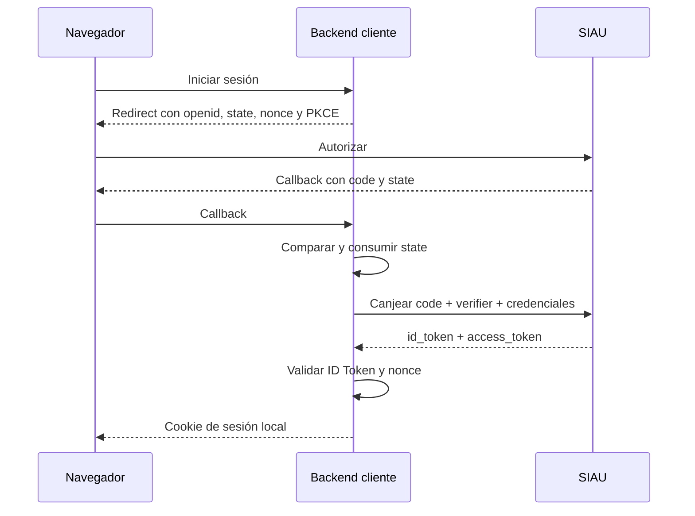

# Integración de una aplicación cliente

Esta es la guía oficial para conectar una aplicación con el perfil OIDC mínimo de SIAU. El flujo se implementa en el backend del cliente: el navegador no recibe el secreto, el `id_token` ni el `access_token`.

Los detalles del protocolo están en [SSO, OIDC y Single Logout](sso-flow.md). La arquitectura interna está en [Visión general](overview.md).

## 1. Registrar la aplicación

Solicita un registro por ambiente y conserva:

- `clientId`;
- `clientSecret` para el backend confidencial;
- `launchUrl`, normalmente el endpoint que inicia SSO;
- `redirectUris` exactas;
- `backchannelLogoutUri`.

Guarda el secreto en un gestor de secretos o variable protegida; no lo incluyas en código, repositorios, logs ni respuestas al frontend. El administrador de SIAU debe asignar a la aplicación los usuarios autorizados.

## 2. Configurar el backend cliente

| Variable | Contenido |
| --- | --- |
| `SIAU_BASE_URL` | URL pública de SIAU y `iss` esperado. |
| `SIAU_CLIENT_ID` | `clientId` asignado. |
| `SIAU_CLIENT_SECRET` | Secreto del cliente confidencial. |
| `SIAU_REDIRECT_URI` | Callback exacto registrado. |
| `SIAU_BACKCHANNEL_LOGOUT_URI` | Receptor de Single Logout. |

Las rutas fijas son `/oauth/authorize`, `/oauth/token`, `/.well-known/jwks.json` y `/internal/sessions/logout`. Este perfil no publica discovery.

## 3. Implementar Authorization Code + PKCE

Por cada inicio de sesión, el backend cliente debe:

1. Generar `state`, `nonce` y `code_verifier` aleatorios e impredecibles.
2. Calcular el `code_challenge` PKCE mediante S256.
3. Guardar `state`, `nonce` y `code_verifier` server-side, asociados al navegador y con expiración corta.
4. Redirigir a `/oauth/authorize` con `response_type=code`, `scope=openid`, `client_id`, `redirect_uri`, `state`, `nonce`, `code_challenge` y `code_challenge_method=S256`.
5. En el callback, comparar y consumir `state`; rechazar valores ausentes, vencidos o diferentes.
6. Canjear el `code` una sola vez desde el backend, usando HTTP Basic, la misma `redirect_uri` y el `code_verifier`.

Un error `access_denied` indica que el usuario no cumple las condiciones de cuenta o acceso y no debe provocar un ciclo automático de reintentos.

## 4. Validar el ID Token

Antes de crear la sesión local, valida:

- firma RS256 y `kid` contra el JWKS;
- `iss` exactamente igual a `SIAU_BASE_URL`;
- `aud` igual al `clientId`;
- `iat` razonable y `exp` vigente;
- `nonce` igual al valor guardado para ese intento;
- presencia y tipo esperado de `sub`, `sid`, `externalKey` y `name`.

Consume también el `nonce` y el resto del estado temporal del intento para impedir reutilización. El `id_token` establece la identidad; no uses el access token como sustituto ni dependas de él para mantener la sesión.

## 5. Crear la sesión local y vincular al usuario

La sesión de la aplicación debe ser server-side. Entrega al navegador solo una cookie propia, opaca, `HttpOnly`, `Secure` en HTTPS y con una política `SameSite` adecuada.

Guarda al menos:

- identificador local del usuario;
- `sid` para correlación de logout;
- los datos de identidad mínimos que la aplicación necesite.

Usa `externalKey` como vínculo estable y único con el usuario local. No uses `login`, nombre, correo ni `sub` como clave institucional de integración.

La estrategia puede ser JIT o vinculación previa, pero nunca debe unir cuentas automáticamente por coincidencia de nombre, login o correo. Los roles, permisos, estado y datos propios siguen siendo responsabilidad del cliente.

SIAU no entrega refresh token. Cuando la aplicación decida terminar o renovar su sesión local, inicia una nueva autorización. Si la sesión SSO central continúa válida, SIAU podrá emitir un nuevo código sin volver a solicitar credenciales, después de revalidar usuario, aplicación, cuenta y asignación.

## 6. Implementar Single Logout

Cuando el usuario cierre sesión, el backend cliente:

1. toma el `sid` de su sesión local;
2. solicita el cierre central en `/internal/sessions/logout`;
3. elimina inmediatamente su propia sesión y cookie, sin esperar la notificación de retorno.

El `backchannelLogoutUri` acepta un `POST` con `logout_token` y debe:

1. validar RS256 y `kid` con el JWKS;
2. exigir `typ=logout+jwt`;
3. validar `iss`, `aud`, `iat`, `exp` y `jti`;
4. exigir `sid` y el evento `http://schemas.openid.net/event/backchannel-logout`;
5. rechazar un Logout Token que contenga `nonce`;
6. eliminar de forma idempotente todas las sesiones locales asociadas al `sid`.

SIAU también enviará esta notificación si el usuario es desactivado, cambian sus credenciales o se retira su acceso a la aplicación.

## Checklist de migración

- [ ] Registro y secretos separados por ambiente.
- [ ] `redirect_uri` y `backchannelLogoutUri` correctas.
- [ ] `scope=openid`, `state`, `nonce` y PKCE S256 generados por intento.
- [ ] Estado temporal guardado y consumido server-side.
- [ ] Canje del code desde el backend mediante HTTP Basic.
- [ ] ID Token validado con JWKS, RS256, `kid`, `iss`, `aud`, `iat`, `exp` y `nonce`.
- [ ] Usuario local vinculado por `externalKey`.
- [ ] Sesión local server-side correlacionada por `sid`.
- [ ] Eliminada toda lógica de refresh token del cliente.
- [ ] Logout local inmediato y receptor back-channel idempotente.
