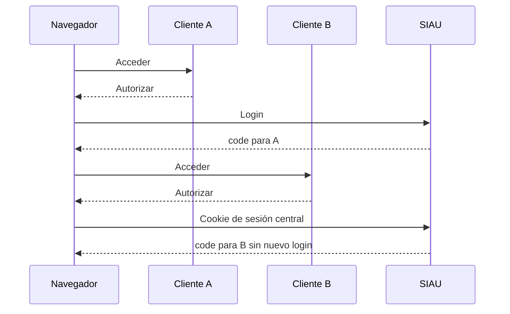
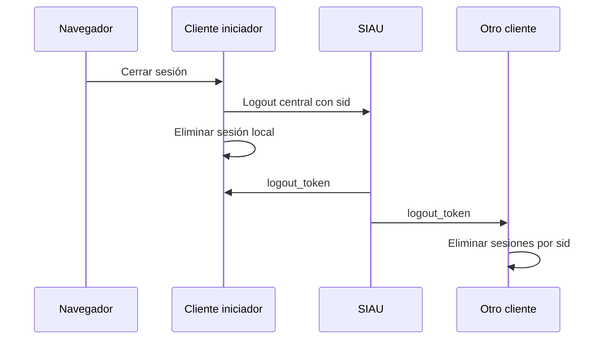

# SSO, OAuth y Single Logout

Este documento describe el contrato técnico de autenticación entre SIAU y sus aplicaciones cliente. Las obligaciones de implementación del cliente están resumidas en [Integración de una aplicación cliente](client-integration.md).

## Sesión central y sesión local

SIAU mantiene una sesión central en su dominio. Cada aplicación mantiene una sesión local independiente.

- `sessionId` identifica la sesión central mediante la cookie privada `session_id`; nunca se entrega al cliente.
- `sid` correlaciona la sesión central con las sesiones locales participantes. Aparece en los tokens, pero no autentica por sí solo.

La sesión central tiene expiración absoluta. Reutilizarla para entrar a otra aplicación evita pedir credenciales de nuevo, pero no extiende su vigencia.

## Authorization Code con PKCE

El cliente inicia la autorización con:

```http
GET /oauth/authorize?response_type=code&client_id=<clientId>&redirect_uri=<uri>&state=<state>&code_challenge=<challenge>&code_challenge_method=S256
```

SIAU valida que la aplicación esté activa, que `redirect_uri` coincida exactamente con una URI registrada y que el usuario esté habilitado. Si no existe una sesión central válida, conserva temporalmente la solicitud y conduce al usuario por el login. Después devuelve al callback:

```text
<redirect_uri>?code=<code>&state=<state>
<redirect_uri>?error=access_denied&state=<state>
```

El authorization code es temporal y de un solo uso. El backend de un cliente confidencial lo canjea así:

```http
POST /oauth/token
Content-Type: application/x-www-form-urlencoded
Authorization: Basic <base64(formEncode(clientId):formEncode(clientSecret))>

grant_type=authorization_code&code=<code>&redirect_uri=<uri>&code_verifier=<verifier>
```

`redirect_uri` debe ser idéntica a la usada durante la autorización. SIAU verifica además el `code_verifier` contra el challenge S256.

## Tokens y refresh

Una respuesta exitosa contiene:

| Campo | Tipo y significado |
| --- | --- |
| `access_token` | JWT firmado. |
| `refresh_token` | Token opaco y rotativo. |
| `token_type` | `Bearer`. |
| `expires_in` | Entero: vigencia restante del access token, en segundos. |
| `refresh_token_expires_in` | Entero: ventana restante de renovación, en segundos. |

El access token está firmado con RS256 y contiene, entre otros, `iss`, `aud`, `exp`, `sub`, `sid`, `externalKey`, `name` y `clientId`. El JWKS se publica en `GET /.well-known/jwks.json`.

El refresh usa el mismo endpoint:

```http
POST /oauth/token
Content-Type: application/x-www-form-urlencoded
Authorization: Basic <credenciales del cliente>

grant_type=refresh_token&refresh_token=<token-actual>
```

Cada refresh exitoso consume el token presentado y devuelve uno nuevo. La operación de rotación y la comprobación de la sesión central son atómicas. `refresh_token_expires_in` refleja la vida restante de esa sesión; no concede una ventana completa nueva.

Los errores del endpoint usan `error` y `error_description`. `invalid_grant` invalida el code o refresh presentado. Un error transitorio de infraestructura no demuestra por sí solo que la credencial haya sido consumida o invalidada.

## Reutilización de SSO



SIAU registra como participante a cada cliente que completa el canje. Ese conjunto determina qué aplicaciones reciben una notificación de Single Logout.

## Single Logout

Un cliente participante puede iniciar el cierre desde su backend:

```http
POST /internal/sessions/logout
Authorization: Basic <credenciales del cliente>
Content-Type: application/json

{ "sid": "<uuid>" }
```

SIAU comprueba que el solicitante participó en esa sesión, elimina la sesión central y envía un `POST` a cada `backchannelLogoutUri` participante:

```text
Content-Type: application/x-www-form-urlencoded

logout_token=<JWT>
```

El Logout Token usa RS256, header `typ: logout+jwt` y contiene `iss`, `aud`, `iat`, `exp`, `jti`, `sid` y el evento estándar:

```json
{
  "events": {
    "http://schemas.openid.net/event/backchannel-logout": {}
  }
}
```

No contiene `nonce`. La clave de `events` es un identificador, no una URL que deba consultarse. Cada receptor valida el JWT y elimina todas sus sesiones locales asociadas al `sid`.



Los envíos back-channel son independientes. El fallo de un receptor se registra, pero no revierte el cierre central ni el de otros clientes. SIAU no depende de redirigir el navegador para propagar el logout.
