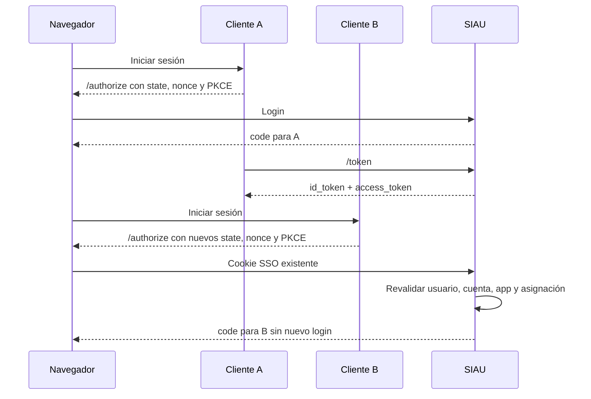

# SSO, OIDC y Single Logout

Este documento explica el protocolo y el estado que SIAU mantiene durante SSO y Single Logout. Los ejemplos de peticiones y las instrucciones completas para implementarlo en un cliente están en [Integración de una aplicación cliente](client-integration.md).

## Sesión central y sesión local

SIAU mantiene una sesión central server-side en su dominio. Cada aplicación mantiene una sesión local independiente.

- `session_id` es la cookie privada de la sesión central y nunca se entrega al cliente.
- `sid` correlaciona esa sesión con las sesiones locales participantes; no autentica por sí solo.
- Reutilizar SSO evita pedir credenciales de nuevo, pero no extiende la expiración absoluta de la sesión central.

La cookie central es `HttpOnly`; sus opciones `Secure` y `SameSite` dependen del ambiente. El issuer (`iss`) es exactamente `IDENTITY_HUB_PUBLIC_URL`. `IDENTITY_HUB_UI_URL` permite servir la UI en otro origen y habilita CORS con credenciales solo para ese origen.

## Authorization Code con PKCE y OpenID Connect

El cliente inicia `/oauth/authorize` con un `state`, un `nonce` y un challenge PKCE nuevos por intento. `state` correlaciona el callback, `nonce` vincula el ID Token con la autorización y PKCE vincula el canje con quien inició la solicitud.

SIAU valida la forma de los parámetros y exige exactamente:

- `response_type=code`;
- `scope=openid`;
- `state` y `nonce` no vacíos;
- challenge PKCE válido y `code_challenge_method=S256`.

Antes de emitir cada código, incluso con una sesión SSO existente, también comprueba:

- usuario activo y versión de credenciales vigente;
- aplicación activa;
- `redirect_uri` registrada mediante coincidencia exacta;
- asignación vigente del usuario a la aplicación.

Si no existe una sesión central válida, SIAU conserva temporalmente la solicitud completa, incluido el `nonce`, y conduce al login. El resultado vuelve al callback con el mismo `state`:

```text
<redirect_uri>?code=<code>&state=<state>
<redirect_uri>?error=access_denied&state=<state>
```

El authorization code guarda de forma temporal `clientId`, `redirectUri`, `scope`, `nonce`, PKCE, `sid`, usuario y versión de credenciales.

## Canje y tokens

Un cliente confidencial canjea el código desde su backend en `/oauth/token`, autenticado mediante HTTP Basic y presentando la misma `redirect_uri` y el `code_verifier` original.

SIAU vuelve a comprobar cliente activo, usuario elegible, asignación, versión de credenciales, sesión central, URI exacta y PKCE. Consumir el código, comprobar la sesión por `sid` y registrar al cliente participante es una operación atómica. El código es de un solo uso.

La respuesta incluye `access_token`, `id_token`, `token_type=Bearer` y `expires_in`. No se emite refresh token y `grant_type=refresh_token` no está soportado.

El `id_token` usa RS256 y contiene únicamente los claims de identidad y protocolo requeridos:

```text
iss
sub
aud
iat
exp
nonce
sid
externalKey
name
```

- `sub` es el identificador OIDC estable del usuario.
- `aud` es el `clientId`.
- `nonce` es exactamente el recibido en la autorización.
- `externalKey` es el vínculo institucional para el usuario local.
- `sid` correlaciona la sesión local con Single Logout.

El JWKS se publica en `GET /.well-known/jwks.json` con `kid=main-key`; ID Tokens, access tokens y Logout Tokens usan el mismo par RSA. El access token se entrega como parte normal de OAuth, pero este perfil no lo usa para sostener la sesión local.

## Reutilización de SSO



## Revocación y Single Logout

SIAU conserva los clientes participantes por `sid`, registrados al completar el canje del código. El cierre central puede iniciarse en SIAU o desde el backend de un cliente participante mediante `/internal/sessions/logout`, autenticado con HTTP Basic e indicando el `sid`.

También disparan revocación la desactivación del usuario, los cambios de credenciales y el retiro de una asignación. Al revocar una sesión completa se conserva la información necesaria para notificar a todos sus participantes; al retirar una asignación se notifica únicamente al cliente afectado. El modelo de contraseñas e invalidación se describe en [Visión general](overview.md#contraseñas-e-invalidación).

Cada `backchannelLogoutUri` recibe un `POST` de formulario con `logout_token`.

El Logout Token usa RS256, header `typ: logout+jwt` y contiene `iss`, `aud`, `iat`, `exp`, `jti`, `sid` y el evento estándar:

```json
{
  "events": {
    "http://schemas.openid.net/event/backchannel-logout": {}
  }
}
```

No contiene `nonce`. Cada receptor valida el JWT y elimina todas sus sesiones locales asociadas al `sid`. El endpoint receptor debe ser idempotente. Un fallo de entrega se registra, pero no restaura la sesión o participación ya revocada.
