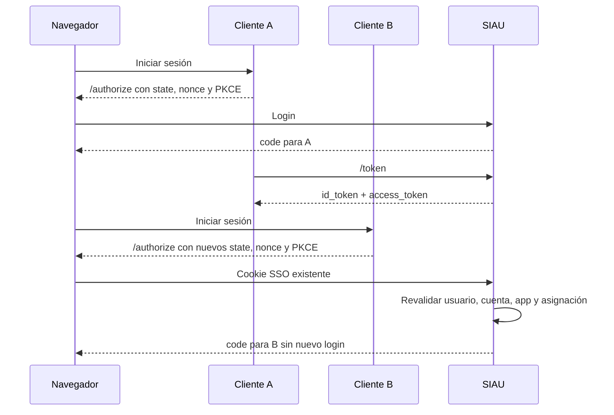

# SSO, OIDC y Single Logout

Este documento describe el contrato técnico entre SIAU y sus aplicaciones cliente. Las obligaciones del integrador están resumidas en [Integración de una aplicación cliente](client-integration.md).

## Sesión central y sesión local

SIAU mantiene una sesión central server-side en su dominio. Cada aplicación mantiene una sesión local independiente.

- `session_id` es la cookie privada de la sesión central y nunca se entrega al cliente.
- `sid` correlaciona esa sesión con las sesiones locales participantes; no autentica por sí solo.
- Reutilizar SSO evita pedir credenciales de nuevo, pero no extiende la expiración absoluta de la sesión central.

## Authorization Code con PKCE y OpenID Connect

Por cada intento de inicio, el cliente genera y guarda server-side un `state`, un `nonce` y un `code_verifier`. Inicia la autorización con:

```http
GET /oauth/authorize?response_type=code&client_id=<clientId>&redirect_uri=<uri>&scope=openid&state=<state>&nonce=<nonce>&code_challenge=<challenge>&code_challenge_method=S256
```

SIAU valida la forma de los parámetros y exige exactamente:

- `response_type=code`;
- `scope=openid`;
- `state` y `nonce` no vacíos;
- challenge PKCE válido y `code_challenge_method=S256`.

Antes de emitir cada código, incluso con una sesión SSO existente, también comprueba:

- usuario activo y versión de credenciales vigente;
- aplicación activa;
- `redirect_uri` registrada mediante coincidencia exacta;
- asignación vigente del usuario a la aplicación.

Si no existe una sesión central válida, SIAU conserva temporalmente la solicitud completa, incluido el `nonce`, y conduce al login. El resultado vuelve al callback con el mismo `state`:

```text
<redirect_uri>?code=<code>&state=<state>
<redirect_uri>?error=access_denied&state=<state>
```

El authorization code guarda de forma temporal `clientId`, `redirectUri`, `scope`, `nonce`, PKCE, `sid`, usuario y versión de credenciales.

## Canje y tokens

Un cliente confidencial canjea el código desde su backend:

```http
POST /oauth/token
Content-Type: application/x-www-form-urlencoded
Authorization: Basic <base64(formEncode(clientId):formEncode(clientSecret))>

grant_type=authorization_code&code=<code>&redirect_uri=<uri>&code_verifier=<verifier>
```

SIAU vuelve a comprobar cliente activo, usuario elegible, asignación, versión de credenciales, sesión central, URI exacta y PKCE. Consumir el código, comprobar la sesión por `sid` y registrar al cliente participante es una operación atómica. El código es de un solo uso.

La respuesta exitosa es:

```json
{
  "access_token": "<jwt>",
  "id_token": "<jwt>",
  "token_type": "Bearer",
  "expires_in": 600
}
```

No se emite refresh token y `grant_type=refresh_token` no está soportado.

El `id_token` usa RS256 y contiene únicamente los claims de identidad y protocolo requeridos:

```text
iss
sub
aud
iat
exp
nonce
sid
externalKey
name
```

- `sub` es el identificador OIDC estable del usuario.
- `aud` es el `clientId`.
- `nonce` es exactamente el recibido en la autorización.
- `externalKey` es el vínculo institucional para el usuario local.
- `sid` correlaciona la sesión local con Single Logout.

El JWKS se publica en `GET /.well-known/jwks.json`. El access token también está firmado con RS256 y se entrega como parte normal de OAuth, pero este perfil no lo usa para sostener la sesión local.

## Reutilización de SSO



## Revocación y Single Logout

SIAU conserva los clientes participantes por `sid`. Un cliente participante puede iniciar cierre central desde su backend:

```http
POST /internal/sessions/logout
Authorization: Basic <credenciales del cliente>
Content-Type: application/json

{ "sid": "<uuid>" }
```

También disparan revocación la desactivación del usuario, los cambios de credenciales y el retiro de una asignación. Al revocar una sesión completa se notifica a todos sus participantes; al retirar una asignación se notifica únicamente al cliente afectado.

Cada `backchannelLogoutUri` recibe:

```text
Content-Type: application/x-www-form-urlencoded

logout_token=<JWT>
```

El Logout Token usa RS256, header `typ: logout+jwt` y contiene `iss`, `aud`, `iat`, `exp`, `jti`, `sid` y el evento estándar:

```json
{
  "events": {
    "http://schemas.openid.net/event/backchannel-logout": {}
  }
}
```

No contiene `nonce`. Cada receptor valida el JWT y elimina todas sus sesiones locales asociadas al `sid`. El endpoint receptor debe ser idempotente. Un fallo de entrega se registra, pero no restaura la sesión o participación ya revocada.
